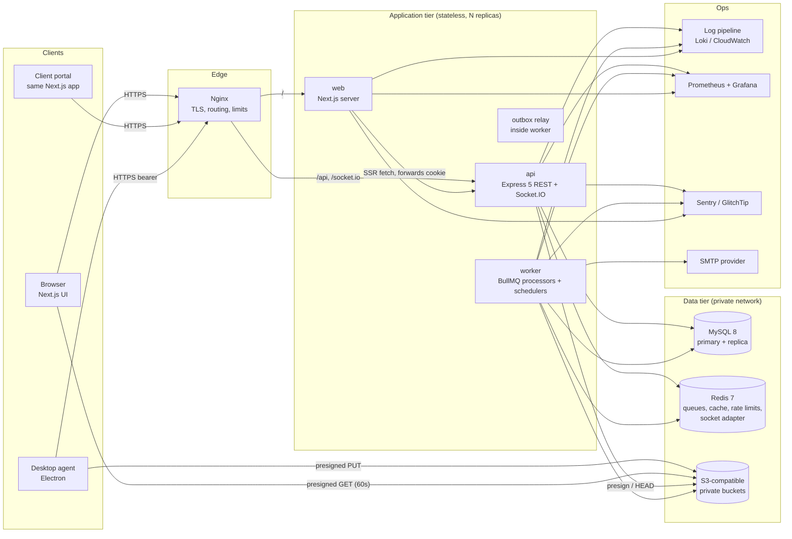
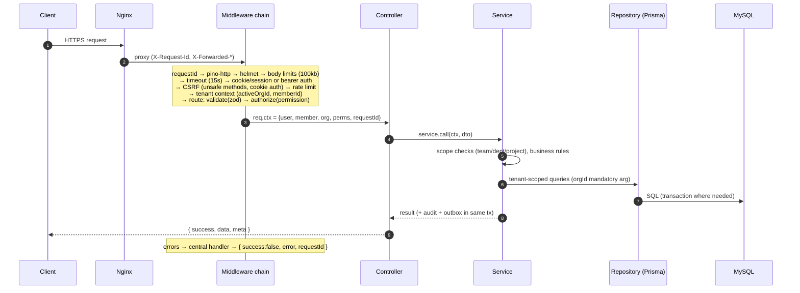

# System Architecture

## 1. Container diagram



**Rules**

1. Express holds **all** business logic. Next.js renders UI. Its server components may call
   the API using the user's forwarded cookie, but Next.js has no route handlers containing
   business rules and never touches the database.
2. API and worker are **one codebase, two entry points** (`server.js`, `worker.js`). They
   share services and repositories, so job logic and request logic cannot drift apart.
3. MySQL, Redis, and object storage are reachable only from the application network.
4. Screenshot binaries never pass through the API or MySQL. Only metadata does.

## 2. Request lifecycle (API)



## 3. Key data flows

### 3.1 Clock-in, then timer start

```mermaid
sequenceDiagram
  participant U as Employee (web)
  participant A as API
  participant DB as MySQL
  participant Q as Redis/BullMQ
  participant IO as Socket.IO
  U->>A: POST /attendance/clock-in (Idempotency-Key)
  A->>DB: BEGIN; SELECT member_work_states ... FOR UPDATE
  A->>A: assert state = OFF (else 409)
  A->>DB: INSERT work_session(started_at = NOW(3)), upsert attendance_record(work_date)
  A->>DB: UPDATE member_work_states SET state=WORKING, version=version+1
  A->>DB: INSERT activity_event, audit_log, outbox_event; COMMIT
  A-->>U: 201 {workSession, state}
  Note over Q: outbox relay → queues: notifications, dashboards
  Q->>IO: emit "presence.changed" to org:{id}:presence room (authorized viewers)
```

The same per-member row lock serializes every attendance, break, and timer transition.
That makes duplicate clock-ins, overlapping sessions, and double timers impossible even
when requests race across replicas.

### 3.2 Screenshot upload

Covered end to end in [screenshot-monitoring.md](screenshot-monitoring.md#upload-pipeline).

### 3.3 Timesheet approval

`POST /timesheets/:id/approve` runs one transaction:
1. Lock the timesheet `FOR UPDATE`.
2. Assert it is `SUBMITTED` and the approver has `timesheets.approve` with a scope that covers the owner. Approvers cannot approve their own timesheet.
3. Insert an immutable `timesheet_approvals` row.
4. Set the status to `APPROVED`. Set `locked_at` on the linked time entries.
5. Write audit and outbox rows.

Notification and webhook delivery happen asynchronously.

### 3.4 Large report

`POST /reports/jobs` validates filters and permission, inserts `report_jobs (QUEUED)`, and
enqueues the job. The worker streams query results with keyset pagination from the **read
replica** into CSV/PDF in object storage, then marks the job `COMPLETED`, then notifies.
Downloads go through `GET /reports/jobs/:id/download`, which re-checks permission and then
302-redirects to a 60 s signed URL.

## 4. Backend module architecture

```
routes  →  controller  →  service  →  repository  →  Prisma
  │            │             │
  │            │             ├─ policy helpers (permissions.js: scope resolution)
  │            │             ├─ audit.record(tx, …)       (same transaction)
  │            │             └─ outbox.enqueue(tx, …)     (same transaction)
  │            └─ maps DTO ↔ HTTP, never touches Prisma
  └─ declares: method, path, zod schemas, required permission, rate-limit class, idempotent?
```

- `module.routes.js` declares each route **declaratively**, e.g.
  `route.post('/clock-in', { body: clockInSchema, permission: 'attendance.self', idempotent: true }, ctl.clockIn)`.
  The same declarations generate the OpenAPI document (`zod-openapi`). The docs therefore
  cannot drift from validation.
- Every query on a tenant model filters by `organizationId`. A Prisma client extension
  (`repositories/tenant-guard.js`) enforces it: outside production it throws on unscoped reads,
  writes and creates. The few legitimately cross-tenant queries (listing a user's memberships at
  login, purging expired idempotency keys) use the explicitly named `prisma.unscoped` client, and
  lookups by a globally unique token hash are allow-listed.
- Services query Prisma directly. Separate repository files are introduced only where queries are
  reused across modules. `*.routes.js` files hold the route declarations plus thin HTTP handlers (the
  controller layer), which avoids one file per layer for one-line handlers.
- Cross-module calls go service → service, never into another module's repository.

## 5. Architectural decisions and trade-offs

| # | Decision | Alternatives considered | Why / trade-off |
|---|---|---|---|
| D1 | **Modular monolith API + separate worker process** | Microservices | One deployable, one transaction boundary, simpler auth. Module boundaries (no cross-module repository access) keep extraction possible later. Trade-off: one big codebase with discipline enforced by lint rules (`eslint-plugin-boundaries`). |
| D2 | **Opaque server sessions in HttpOnly cookies** (web); **device-bound short-lived tokens** (agent) | JWT access + refresh in browser | Instant revocation, no token in JS, simpler CSRF story when same-origin. Session lookup cost is mitigated by a Redis cache (60 s) backed by MySQL `user_sessions`. The agent cannot use cookies sensibly, so it gets 15-min access tokens obtained by signing a challenge with a device private key in the OS keychain. No long-lived bearer secret sits on disk. |
| D3 | **Shared schema, `organization_id` on every tenant row, composite FKs** | DB-per-tenant, schema-per-tenant | Cheapest to operate at 500 orgs, and migrations run once. Isolation is enforced at three layers: (1) composite FKs `(organization_id, x_id) → x(organization_id, id)` make cross-org references impossible in the DB; (2) repositories require `orgId`; (3) authorization checks. Trade-off: a noisy tenant can affect others. Mitigated by per-org rate limits and report job quotas. |
| D4 | **Global identity + per-org membership** | User row per org | Supports contractors and client users in several orgs. Tenant tables reference `(organization_id, user_id) → organization_members`, so the DB guarantees the user belongs to that org. Trade-off: login needs an org-selection step when a user has more than one membership. |
| D5 | **Per-member state row (`member_work_states`) locked `FOR UPDATE`** | Generated-column unique indexes, Redis locks | Serializes all clock, break, and timer transitions per member using plain InnoDB row locks. Portable, Prisma-friendly, works across replicas. An optimistic `version` column lets clients detect stale state. |
| D6 | **Prisma 6.x with the `prisma-client-js` generator** | Prisma 7 `prisma-client` generator, Drizzle, Knex | Prisma 7's new generator emits TypeScript source into the project, which violates the JS-only rule. `prisma-client-js` emits JS into `node_modules/.prisma` (its bundled `.d.ts` files are vendor artifacts, not authored). Pinned at Phase 2. Upgrading needs an ADR. Composite relations and `uuid(7)` defaults are supported. |
| D7 | **UUIDv7 primary keys (`CHAR(36)`)** | Auto-increment, CUID, `BINARY(16)` | Time-ordered (good InnoDB locality), non-enumerable, safe to expose. `BINARY(16)` would save space but is awkward in Prisma and in debugging. Trade-off: about 20 extra bytes per key and index entry, which is accepted at design scale. |
| D8 | **Transactional outbox** (`outbox_events`) relayed to BullMQ | Enqueue directly after commit | A crash between commit and enqueue would lose notifications or webhooks. The relay polls `FOR UPDATE SKIP LOCKED`, which gives at-least-once delivery. Consumers are idempotent (dedupe keys). |
| D9 | **Presigned direct-to-storage uploads** | Stream through API | Keeps large binaries off API memory and bandwidth. Validation happens on `complete` (HEAD + checksum) and in an async processing job (decode, dimensions, re-encode). |
| D10 | **Electron for the desktop agent** | Tauri | Tauri's core is Rust, which breaks the JS-only constraint. Electron has `desktopCapturer`, a mature auto-updater with code signing, and `safeStorage` / keychain access. Trade-off: larger binary (~90 MB). |
| D11 | **Socket.IO with Redis adapter. Rooms are server-assigned.** | SSE, raw WS | Bidirectional, reconnection, horizontal fan-out. Clients never "join" rooms themselves. The server joins them to rooms derived from their permissions at handshake and on permission change. |
| D12 | **Durations as integer seconds. Money as `DECIMAL(19,4)` handled via `Prisma.Decimal`.** | Floats | No float rounding. Monetary maths runs in `decimal.js`. Invoices round line totals to the currency's minor units with banker's rounding (configurable to half-up per org). |
| D13 | **High-volume append-only tables have no FKs and a PK that includes the timestamp** (`activity_events`, `audit_logs`, `screenshot_access_logs`, `agent_heartbeats`) | Normal FKs | MySQL cannot partition tables that have foreign keys. Designing for `PARTITION BY RANGE (occurred_at)` from day one allows cheap monthly drop-partition retention. Referential integrity there is enforced in the application. These tables are write-once, so the risk is low. |
| D14 | **Sync-or-async reports** | Always async | Small queries return inline for good UX. Bounded queries prevent the API from streaming millions of rows. Large ones go to the worker against the read replica. |
| D15 | **Shared Zod schemas in `packages/validation`** used by web forms and API | Duplicate schemas | Shapes and constraints are defined once. Business rules (state machines, approvals, scope) stay in API services only. |
| D16 | **Pino structured logs, prom-client metrics, Sentry SDK (DSN optional)** | — | Standard and cheap. GlitchTip is a self-hosted Sentry-compatible option. |

## 6. Real-time design

- Handshake: the API authenticates using the session cookie (web) or the agent bearer token. It rejects connections without a valid session or with a disallowed origin.
- Server-assigned rooms: `user:{userId}`, `member:{memberId}`, `org:{orgId}:presence` (only for members holding `attendance.read` at org scope), `team:{teamId}:presence` (team leads), `project:{projectId}` (project members), `report-job:{jobId}` (job owner).
- A permission or role change publishes `perm.changed`. The socket layer recomputes rooms for that member's sockets. Session revocation disconnects the sockets.
- Events are thin: an id and type. Clients refetch through REST (TanStack Query invalidation), so socket payloads never bypass REST authorization.

## 7. Time and calendar rules

| Concern | Rule |
|---|---|
| Storage | `DATETIME(3)` in UTC. MySQL session `time_zone = '+00:00'`. Prisma `DateTime`. |
| Authority | Attendance and timer timestamps use the API server clock (NTP-synced hosts). Client-supplied times are accepted only on correction or manual-entry endpoints, and those are permission-checked and audited. |
| Work date | Calendar date in the member's effective time zone at session **start**. Stored as `DATE` (`work_date`) on `attendance_records`. |
| Schedules | Defined in local wall-clock time + IANA zone. Expanded per date with Luxon. **DST gap** (local time doesn't exist): shift forward to the first valid instant. **DST overlap** (local time occurs twice): use the earlier offset. Durations are always computed from UTC instants, so a 23h or 25h day is reported accurately. |
| Overnight | A shift with end ≤ start ends on the next local date. Sessions may span midnight and are not split. Reports that bucket by day clip intervals at local midnight. |
| Offline | Web clock actions require connectivity. They fail visibly and are never queued silently. The agent queues **captures** (not attendance) while offline and uploads them later with `captured_at` from the agent clock. Each upload is checked: it must fall inside a server-recorded work session ± 2 min skew tolerance, otherwise it is rejected as `OUTSIDE_SESSION`. |
| Missed clock-out | See FR-ATT-3. The auto-close time is `min(last activity/heartbeat, schedule end)`, flagged and correctable. |
