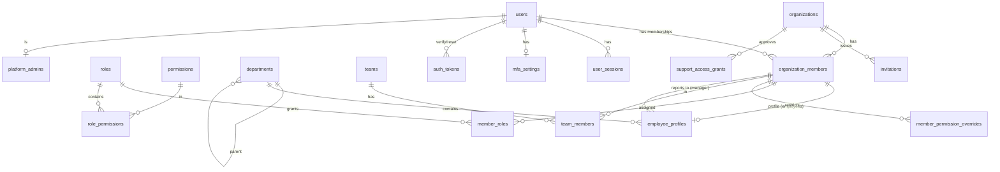
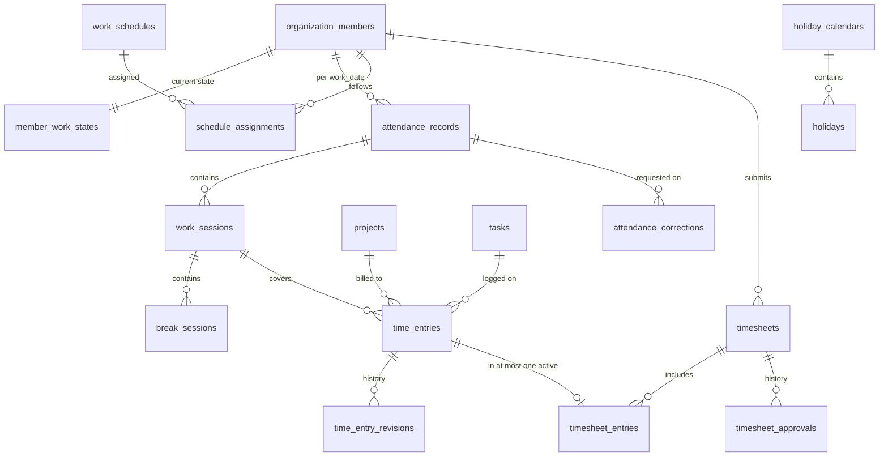
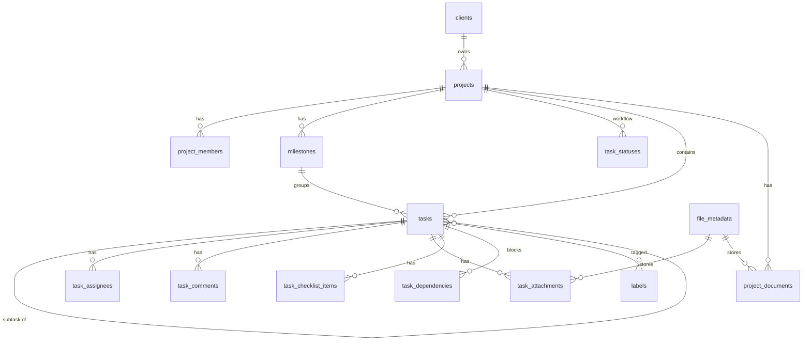
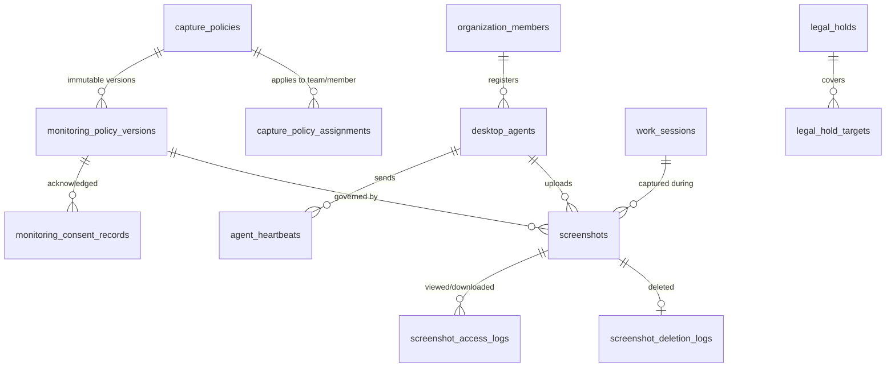
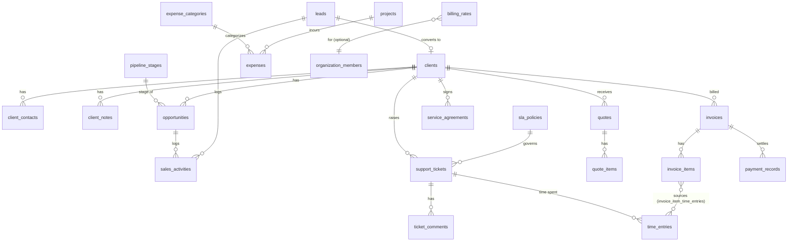

# Database Design (MySQL 8, Prisma)

This is the Phase 1 logical design. The full `schema.prisma` is written in Phase 2/3 from
this document and kept in sync with it. Any divergence is a documentation bug.

## 1. Conventions

| Topic | Convention |
|---|---|
| Engine / charset | InnoDB, `utf8mb4`, `utf8mb4_unicode_ci` (Prisma's MySQL default; case-insensitive search on names and emails) |
| Naming | Tables `snake_case` plural. Prisma models `PascalCase` with `@@map`. Columns `snake_case` via `@map`. |
| Primary keys | `id CHAR(36)` UUIDv7 (`@default(uuid(7))`), except where noted |
| Tenant ownership | Every tenant-owned table has `organization_id CHAR(36) NOT NULL` and `UNIQUE (organization_id, id)` |
| Cross-entity FKs | **Composite**: `(organization_id, project_id) → projects(organization_id, id)`. A row can never point at another org's record. |
| Member references | `(organization_id, user_id) → organization_members(organization_id, user_id)`. This guarantees the user is a member of that org. |
| Timestamps | `created_at`, `updated_at` as `DATETIME(3)` UTC on every mutable table. `@updatedAt`. |
| Soft deletion | `archived_at DATETIME(3) NULL` for business entities (projects, clients, tasks, employees). Hard delete only via retention jobs or data-erasure workflows. |
| Deletion rules | Composite tenant FKs use `ON DELETE RESTRICT` (Prisma can't `SET NULL` a column shared with `organization_id`). Pure child rows (e.g. `invoice_items`) use `CASCADE` from their parent. |
| Money | `DECIMAL(19,4)` + `currency CHAR(3)` on the same row |
| Durations | `INT UNSIGNED` seconds (`duration_s`) |
| Enums | Prisma enums (MySQL `ENUM`) for closed sets. Lookup tables for org-configurable sets (task statuses, pipeline stages, leave types). |
| Optimistic concurrency | `version INT NOT NULL DEFAULT 0` on rows edited concurrently (timesheets, invoices, member_work_states, tasks) |
| JSON | `JSON` only for genuinely schemaless data (settings blobs, audit diffs, webhook payloads), never for queryable relations |

### Prisma pattern for tenant-safe relations

```prisma
model Project {
  id             String   @id @default(uuid(7)) @db.Char(36)
  organizationId String   @map("organization_id") @db.Char(36)
  clientId       String?  @map("client_id") @db.Char(36)
  // ...
  organization   Organization @relation(fields: [organizationId], references: [id], onDelete: Restrict)
  client         Client?      @relation(fields: [organizationId, clientId], references: [organizationId, id], onDelete: Restrict, onUpdate: Restrict)

  @@unique([organizationId, id])
  @@index([organizationId, status, archivedAt])
  @@map("projects")
}
```

MySQL skips the FK check when any FK column is NULL, so an optional composite relation
behaves correctly while `client_id` is NULL.

## 2. ER diagrams

Diagrams are split by domain for readability. `ORG` = `organizations`, and every entity
below links to it (omitted from the lines).

### 2.1 Identity, organization, RBAC



### 2.2 Attendance, time, timesheets



### 2.3 Projects & tasks



### 2.4 Monitoring



### 2.5 CRM, tickets, finance



## 3. Entities

Every tenant table also has `organization_id` + `UNIQUE(organization_id, id)` + timestamps
unless stated otherwise. "→" means a composite tenant FK.

### 3.1 Identity & organization

| Table | Key columns | Constraints & indexes | Lifecycle |
|---|---|---|---|
| `organizations` | name, slug, logo_file_id, brand_color, time_zone, base_currency, locale, week_start, status (TRIAL/ACTIVE/SUSPENDED/CLOSED), seat_limit, storage_limit_bytes | UNIQUE(slug) | Never hard-deleted. Closure triggers the data-export + purge workflow. |
| `organization_settings` | organization_id (PK), attendance JSON, time_tracking JSON, security JSON (mfa_required_roles, session_ttl), notifications JSON, version | PK(organization_id) | Validated by Zod on write |
| `users` *(global)* | email, email_verified_at, password_hash, name, avatar_file_id, status, failed_login_count, locked_until, last_login_at | UNIQUE(email) | Never returned raw. Erasure = anonymize. |
| `organization_members` | user_id → users, member_type (EMPLOYEE/CLIENT), client_id → clients (client users), status (INVITED/ACTIVE/SUSPENDED/DEACTIVATED/ARCHIVED), joined_at, deactivated_at | UNIQUE(organization_id, user_id), UNIQUE(organization_id, id), IDX(organization_id, status) | Archive, never delete |
| `employee_profiles` | user_id (member ref), employee_code, designation, department_id →, manager_user_id → member, employment_type, employment_status, joining_date, probation_end_date, notice_period_days, last_working_date, work_location, time_zone, phone, personal_email, address JSON, emergency_contact JSON, skills JSON, completion_pct | UNIQUE(organization_id, user_id), UNIQUE(organization_id, employee_code), IDX(organization_id, department_id), IDX(organization_id, manager_user_id) | Sensitive columns (`personal_email`, `address`, `emergency_contact`) encrypted at app level (AES-256-GCM, key per env) |
| `profile_change_history` | user_id (member ref), field, old_value, new_value (redacted for sensitive groups), changed_by, request_id | IDX(organization_id, user_id, created_at) | Append-only |
| `departments` | name, code, parent_id →, manager_user_id → member, archived_at | UNIQUE(organization_id, code) | Archive |
| `teams` | name, department_id →, lead_user_id → member, archived_at | UNIQUE(organization_id, name) | Archive |
| `team_members` | team_id →, user_id → member | PK(team_id, user_id), IDX(organization_id, user_id) | Cascade with team |
| `roles` | organization_id (NULL = system template), key, name, is_system | UNIQUE(organization_id, key) | System roles are copied into each org at creation so orgs can tweak them |
| `permissions` *(global catalog)* | key (e.g. `timesheets.approve`), module, description, allowed_scopes SET | UNIQUE(key) | Seeded from code |
| `role_permissions` | role_id, permission_id, scope ENUM(self/team/department/project/org) | PK(role_id, permission_id) | Cascade with role |
| `member_roles` | user_id → member, role_id → | PK(organization_id, user_id, role_id) | |
| `member_permission_overrides` | user_id → member, permission_id, effect (DENY), reason | UNIQUE(organization_id, user_id, permission_id) | Deny-only, so it can never escalate |
| `invitations` | email, role_ids JSON, department_id, team_ids JSON, token_hash, expires_at, accepted_at, revoked_at, invited_by | UNIQUE(token_hash), IDX(organization_id, email) | Purge 90 d after terminal state |
| `user_sessions` | user_id, active_organization_id, token_hash (SHA-256), ip, user_agent, device_label, created_at, last_seen_at, expires_at, revoked_at, revoke_reason, mfa_verified_at | UNIQUE(token_hash), IDX(user_id, revoked_at) | Purge 180 d after expiry |
| `auth_tokens` | user_id, purpose (VERIFY_EMAIL/RESET_PASSWORD/MFA_CHALLENGE), token_hash, expires_at, used_at | UNIQUE(token_hash) | Purge after 7 d |
| `mfa_settings` | user_id (PK), totp_secret_enc, enabled_at, recovery_codes_hash JSON | | |
| `login_attempts` | email_hash, ip, success, reason, at | IDX(email_hash, at), IDX(ip, at) | Partitioned by month, 90 d retention |
| `platform_admins` | user_id (PK), granted_by | | |
| `support_access_grants` | organization_id, admin_user_id, reason, scope JSON, approved_by, starts_at, expires_at, revoked_at | IDX(organization_id, expires_at) | Kept with audit |

### 3.2 Attendance & time

| Table | Key columns | Constraints & indexes |
|---|---|---|
| `work_schedules` | name, type (FIXED/FLEXIBLE/SHIFT), time_zone (NULL = member's), days JSON `[{weekday, start, end, break_min}]`, required_minutes_per_day/week, grace_late_min, grace_early_min, max_session_min | UNIQUE(organization_id, name) |
| `schedule_assignments` | schedule_id →, target_type (ORG/DEPARTMENT/TEAM/MEMBER), target_id, effective_from, effective_to | IDX(organization_id, target_type, target_id, effective_from). Precedence member > team > department > org. |
| `holiday_calendars` / `holidays` | name, location; holiday: date, name, is_half_day | UNIQUE(calendar_id, date) |
| `member_work_states` | user_id (member ref, PK with org), state (OFF/WORKING/ON_BREAK), work_session_id, break_session_id, timer_state (NONE/RUNNING/PAUSED), time_entry_id, timer_context JSON (project, task, description, billable for resume), last_activity_at, version | PK(organization_id, user_id). **The serialization point for all transitions.** |
| `attendance_records` | user_id → member, work_date DATE, status (PRESENT/ABSENT/ON_LEAVE/HOLIDAY/WEEKEND/PARTIAL), first_in_at, last_out_at, worked_s, break_s, late_by_s, early_by_s, overtime_s, flags SET(LATE, EARLY_LEAVE, MISSED_CLOCK_OUT, CORRECTED), schedule_snapshot JSON | UNIQUE(organization_id, user_id, work_date), IDX(organization_id, work_date, status) |
| `work_sessions` | attendance_record_id →, user_id → member, started_at, ended_at NULL, end_reason (CLOCK_OUT/AUTO_CLOSED/CORRECTION), source (WEB/AGENT/CORRECTION), duration_s (computed on close), superseded_by_id | IDX(organization_id, user_id, started_at), IDX(organization_id, ended_at) for open-session scans |
| `break_sessions` | work_session_id →, started_at, ended_at, type (PAID/UNPAID) | IDX(work_session_id, started_at) |
| `attendance_corrections` | attendance_record_id →, requested_by, kind (ADD/MODIFY/DELETE), target_session_id, proposed JSON, reason, status (PENDING/APPROVED/REJECTED/CANCELLED), reviewed_by, reviewed_at, review_comment | IDX(organization_id, status, created_at) |
| `time_entries` | user_id → member, work_session_id →, project_id →, task_id →, ticket_id →, started_at, ended_at NULL (= running segment), duration_s, description, is_billable, source (TIMER/MANUAL/IMPORT), locked_at, invoiced_at, deleted_at, version | IDX(organization_id, user_id, started_at), IDX(organization_id, project_id, started_at), IDX(organization_id, task_id). Overlap prevented by the service under the member_work_states lock. |
| `time_entry_revisions` | time_entry_id →, revision_no, before JSON, after JSON, reason, changed_by | UNIQUE(time_entry_id, revision_no) |
| `timesheets` | user_id → member, period_start DATE, period_end DATE, status (DRAFT/SUBMITTED/APPROVED/REJECTED), total_s, billable_s, submitted_at, approved_at, version | UNIQUE(organization_id, user_id, period_start), IDX(organization_id, status, period_start) |
| `timesheet_entries` | timesheet_id →, time_entry_id →, active_key (= time_entry_id while the sheet is not REJECTED, NULL when rejected) | UNIQUE(organization_id, active_key) **prevents double-counting**. UNIQUE(timesheet_id, time_entry_id). |
| `timesheet_approvals` | timesheet_id →, action (SUBMIT/APPROVE/REJECT/REOPEN), actor_id, comment, snapshot JSON (totals) | Append-only. No update or delete grant for the app DB user (enforced by triggers). |

### 3.3 Projects & tasks

| Table | Key columns | Constraints & indexes |
|---|---|---|
| `projects` | code, name, client_id →, description, manager_user_id →, start_date, end_date, deadline, status (PLANNED/ACTIVE/ON_HOLD/COMPLETED/CANCELLED), priority, visibility (PRIVATE/ORG), budget_amount, budget_currency, budget_type (FIXED/HOURS/TIME_AND_MATERIALS), estimated_s, is_billable_default, template_id, closed_at, archived_at | UNIQUE(organization_id, code), IDX(organization_id, status, archived_at), IDX(organization_id, client_id), IDX(organization_id, manager_user_id) |
| `project_members` | project_id →, user_id →, project_role (MANAGER/MEMBER/VIEWER) | PK(project_id, user_id), IDX(organization_id, user_id) |
| `milestones` | project_id →, name, due_date, status, sort | IDX(project_id, due_date) |
| `task_statuses` | project_id → (NULL = org default workflow), name, category (TODO/IN_PROGRESS/DONE/CANCELLED), sort, allowed_next JSON | UNIQUE(organization_id, project_id, name) |
| `tasks` | project_id →, parent_id →, milestone_id →, number (per project), title, description (sanitized markdown), status_id →, priority, due_at, start_at, estimated_s, actual_s (rollup), recurrence_rule, recurrence_parent_id, sort, completed_at, archived_at, version | UNIQUE(project_id, number), IDX(organization_id, project_id, status_id), IDX(organization_id, due_at), FULLTEXT(title, description) |
| `task_assignees` | task_id →, user_id → | PK(task_id, user_id), IDX(organization_id, user_id) |
| `task_checklist_items` | task_id →, text, done_at, sort | |
| `task_dependencies` | task_id →, depends_on_task_id →, type (FS) | PK(task_id, depends_on_task_id), cycle check in service |
| `labels` / `task_labels` | name, color / (task_id, label_id) | UNIQUE(organization_id, name) |
| `task_comments` | task_id →, author_id, body, edited_at, deleted_at | IDX(task_id, created_at) |
| `task_attachments` / `project_documents` | parent →, file_id → file_metadata | |
| `calendar_events` | title, start_at, end_at, all_day, kind (MEETING/FOLLOW_UP/OTHER), related_type/id, attendees (calendar_event_attendees) | IDX(organization_id, start_at) |

### 3.4 Leave & HR

| Table | Key columns | Constraints & indexes |
|---|---|---|
| `leave_types` | name, code, is_paid, allows_half_day, requires_document, color | UNIQUE(organization_id, code) |
| `leave_policies` | leave_type_id →, name, accrual (NONE/MONTHLY/ANNUAL/PER_HOUR_WORKED), accrual_amount DECIMAL(6,2), cap, carry_over_max, allow_negative, approval_chain JSON (ordered approver rules) | |
| `leave_policy_assignments` | policy_id →, target_type/id, effective_from | |
| `leave_balance_ledger` | user_id →, leave_type_id →, entry_type (ACCRUAL/USAGE/ADJUSTMENT/CARRY_OVER/EXPIRY/REVERSAL), days DECIMAL(6,2), effective_date, leave_request_id, idempotency_key | UNIQUE(organization_id, idempotency_key), IDX(organization_id, user_id, leave_type_id, effective_date) |
| `leave_balances` | user_id, leave_type_id, year, balance_days (cached from ledger), version | UNIQUE(organization_id, user_id, leave_type_id, year) |
| `leave_requests` | user_id →, leave_type_id →, start_date, end_date, start_half (FULL/AM/PM), end_half, days DECIMAL(6,2), reason, status (PENDING/APPROVED/REJECTED/CANCELLED), current_step | IDX(organization_id, user_id, start_date), IDX(organization_id, status) |
| `leave_approvals` | leave_request_id →, step, approver_id, action, comment | Append-only |
| `employment_documents` | user_id →, type, file_id →, visibility (HR_ONLY/EMPLOYEE), expires_on | |
| `onboarding_checklists` / `onboarding_tasks` | template, user_id, kind (ONBOARDING/OFFBOARDING), assignee, done_at | |

### 3.5 Monitoring

| Table | Key columns | Constraints & indexes |
|---|---|---|
| `capture_policies` | name, scope_level (ORG/TEAM/MEMBER), is_active, current_version_id | One ORG-level policy per org (UNIQUE(organization_id, scope_level='ORG') via `org_singleton` column) |
| `monitoring_policy_versions` | policy_id →, version_no, interval_s, min_interval_s, max_interval_s, schedule JSON, blur (NONE/BLUR), capture_mode (ALL_SCREENS/ACTIVE_SCREEN), excluded_apps JSON, idle_detection_enabled, idle_threshold_s, retention_days, notice_text, published_by, published_at | UNIQUE(policy_id, version_no). Immutable after publish. |
| `capture_policy_assignments` | policy_id →, target_type (TEAM/MEMBER), target_id, priority | UNIQUE(organization_id, target_type, target_id, policy_id) |
| `monitoring_consent_records` | user_id →, policy_version_id →, action (ACKNOWLEDGED/WITHDRAWN), ip, user_agent, notice_hash | IDX(organization_id, user_id, created_at). Append-only. |
| `desktop_agents` | user_id →, device_name, os, os_version, agent_version, public_key (Ed25519), status (ACTIVE/REVOKED), registered_at, last_seen_at, revoked_at, revoked_by | IDX(organization_id, user_id, status) |
| `agent_heartbeats` | agent_id, organization_id, at, capture_state, queue_depth, last_error | PK(id, at), partitioned, 30 d retention, no FKs |
| `screenshots` | user_id →, work_session_id →, project_id →, task_id →, agent_id →, policy_version_id →, client_capture_id (idempotency), captured_at, uploaded_at, storage_key, thumb_key, mime_type, width, height, size_bytes, sha256, status (PENDING_UPLOAD/UPLOADED/PROCESSING/READY/FAILED/REJECTED/DELETED), failure_code, retention_expires_at, legal_hold (bool, cached), deleted_at | UNIQUE(organization_id, agent_id, client_capture_id), IDX(organization_id, user_id, captured_at), IDX(organization_id, project_id, captured_at), IDX(status, retention_expires_at) |
| `screenshot_access_logs` | screenshot_id, organization_id, actor_id, action (VIEW_THUMB/VIEW_FULL/DOWNLOAD), ip, at | PK(id, at), partitioned, no FKs, 2-year retention |
| `screenshot_deletion_logs` | screenshot_id, actor_id (NULL = retention job), reason (RETENTION/MANUAL/ERASURE/OFFBOARDING), storage_deleted_at | Kept for 2 years after deletion |
| `legal_holds` / `legal_hold_targets` | name, reason, created_by, released_at / target_type (MEMBER/PROJECT), target_id, from, to | |

### 3.6 Activity, CRM, finance, platform

| Table | Key columns | Constraints & indexes |
|---|---|---|
| `activity_events` | organization_id, user_id, type, occurred_at, subject_type, subject_id, project_id, metadata JSON | PK(id, occurred_at), IDX(organization_id, user_id, occurred_at), IDX(organization_id, occurred_at). No FKs, monthly partitions. |
| `daily_member_stats` | user_id, date, worked_s, break_s, tracked_s, billable_s, idle_s, screenshots_expected, screenshots_ok, screenshots_failed | UNIQUE(organization_id, user_id, date). Rollup built by job. Drives dashboards. |
| `clients` | code, name, industry, size_band, website, address JSON, country CHAR(2), account_manager_id →, status (PROSPECT/ACTIVE/INACTIVE), default_currency, archived_at | UNIQUE(organization_id, code), FULLTEXT(name) |
| `client_contacts` | client_id →, name, email, phone, title, is_primary | IDX(client_id) |
| `client_notes` / `communications` | client_id →, kind (NOTE/CALL/EMAIL/MEETING), body, occurred_at, author_id | IDX(client_id, occurred_at) |
| `leads` | name, company, email, phone, source, owner_id →, status (NEW/CONTACTED/QUALIFIED/UNQUALIFIED/CONVERTED/LOST), score, follow_up_at, lost_reason, converted_client_id →, converted_opportunity_id → | IDX(organization_id, status, owner_id), IDX(organization_id, follow_up_at) |
| `pipeline_stages` | name, sort, default_probability, is_won, is_lost | UNIQUE(organization_id, name) |
| `opportunities` | client_id →, lead_id →, name, stage_id →, value, currency, probability, expected_close_date, owner_id →, closed_at | IDX(organization_id, stage_id), IDX(organization_id, expected_close_date) |
| `sales_activities` | subject_type (LEAD/OPPORTUNITY/CLIENT), subject_id, kind, due_at, done_at, owner_id | IDX(organization_id, subject_type, subject_id) |
| `sla_policies` | name, per-priority first_response_min / resolution_min, business_hours_schedule_id | |
| `support_tickets` | number, client_id →, project_id →, reporter (member or contact), subject, description, priority, status (OPEN/IN_PROGRESS/WAITING_CLIENT/RESOLVED/CLOSED), team_id →, assignee_id →, sla_policy_id →, first_response_due_at, resolution_due_at, first_responded_at, resolved_at, sla_breached | UNIQUE(organization_id, number), IDX(organization_id, status, priority), IDX(organization_id, resolution_due_at) |
| `ticket_comments` | ticket_id →, author_user_id, visibility (INTERNAL/PUBLIC), body | IDX(ticket_id, created_at) |
| `service_agreements` | client_id →, name, start_date, end_date, terms_file_id, value, currency, status | |
| `quotes` / `quote_items` | client_id →, opportunity_id →, number, version, status (DRAFT/SENT/ACCEPTED/DECLINED/EXPIRED), valid_until, currency, subtotal, tax_total, total / description, quantity DECIMAL(12,4), unit_price, tax_rate DECIMAL(6,4), line_total | UNIQUE(organization_id, number, version) |
| `invoices` | client_id →, project_id →, number, status (DRAFT/ISSUED/PARTIALLY_PAID/PAID/OVERDUE/VOID), issue_date, due_date, currency, subtotal, tax_total, total, amount_paid, notes, voided_at, version | UNIQUE(organization_id, number), IDX(organization_id, status, due_date) |
| `invoice_items` | invoice_id (cascade), kind (TIME/EXPENSE/MANUAL), description, quantity, unit_price, tax_rate, line_total | |
| `invoice_item_time_entries` | invoice_item_id, time_entry_id → | UNIQUE(organization_id, time_entry_id) prevents double-billing |
| `payment_records` | invoice_id →, amount, currency, received_at, method, reference, recorded_by, reconciled_by | Invoice PAID only when Σ payments ≥ total |
| `expense_categories` / `expenses` | name / user_id →, project_id →, client_id →, category_id →, amount, currency, incurred_on, is_billable, receipt_file_id, status (DRAFT/SUBMITTED/APPROVED/REJECTED/REIMBURSED), approved_by | IDX(organization_id, project_id, incurred_on) |
| `billing_rates` | kind (BILL/COST), target_type (ORG/MEMBER/CLIENT/PROJECT/PROJECT_MEMBER), target_id, project_id, amount, currency, effective_from, effective_to | IDX(organization_id, target_type, target_id, effective_from). Non-overlap checked in service. |
| `notifications` | recipient_id →, type, title, body, link, subject_type/id, dedupe_key, read_at | UNIQUE(organization_id, recipient_id, dedupe_key), IDX(recipient_id, read_at, created_at) |
| `notification_preferences` | user_id, type, in_app, email, realtime | PK(organization_id, user_id, type) |
| `audit_logs` | organization_id (NULL = platform), actor_type (USER/AGENT/SYSTEM/API_KEY/SUPPORT), actor_id, action, target_type, target_id, diff JSON (redacted), ip, user_agent, request_id, at | PK(id, at), IDX(organization_id, at), IDX(organization_id, target_type, target_id). Partitioned, append-only, retention configurable (default 2 years). |
| `custom_fields` / `custom_field_values` | entity (EMPLOYEE/PROJECT/TASK/CLIENT/TICKET), key, label, type (TEXT/NUMBER/DATE/SELECT/MULTI_SELECT/BOOLEAN), options JSON, required, visibility_permission / field_id →, entity_id, value_text, value_number DECIMAL(19,4), value_date | UNIQUE(organization_id, entity, key), UNIQUE(field_id, entity_id), IDX(organization_id, field_id, value_text(64)) |
| `file_metadata` | storage_key, bucket, original_name, mime_type, size_bytes, sha256, uploaded_by, purpose, status (PENDING/READY/QUARANTINED/DELETED), scanned_at | UNIQUE(storage_key) |
| `integrations` | provider, status, config JSON, secret_enc (AES-GCM), scopes, last_sync_at, last_error | UNIQUE(organization_id, provider) |
| `api_keys` | name, prefix, key_hash, scopes JSON, expires_at, last_used_at, revoked_at, created_by | UNIQUE(prefix) |
| `webhooks` / `webhook_deliveries` | url, events JSON, secret_enc, is_active, failure_count / webhook_id, event_id, attempt, status_code, response_ms, next_retry_at, delivered_at | delivery IDX(webhook_id, created_at), UNIQUE(webhook_id, event_id, attempt) |
| `report_jobs` | requested_by, type, params JSON, status (QUEUED/RUNNING/COMPLETED/FAILED/EXPIRED), progress, file_id, error, expires_at | IDX(organization_id, requested_by, created_at) |
| `outbox_events` | organization_id, type, payload JSON, dedupe_key, available_at, published_at, attempts | UNIQUE(dedupe_key), IDX(published_at, available_at) |
| `background_job_records` | queue, job_id, name, idempotency_key, status, attempts, last_error, finished_at | UNIQUE(queue, idempotency_key). The worker records job execution for idempotency and ops visibility. |
| `idempotency_keys` | organization_id, user_id, key, method_path, request_hash, response_status, response_body JSON, expires_at | UNIQUE(organization_id, user_id, key), 24 h TTL |

## 4. Indexing strategy

1. **Tenant first.** Every composite index starts with `organization_id`, because every query includes it. That makes the index usable for both tenant scoping and filtering.
2. **Equality → range → sort.** Example: `(organization_id, user_id, started_at)` serves "entries for user X between dates, ordered by start".
3. **Cursor pagination** on event streams (activity, audit, screenshots) uses `(organization_id, <ts>, id)` keyset predicates (`WHERE (ts, id) < (?, ?)`). No `OFFSET` on large tables.
4. **Status partial scans** (open work sessions, pending uploads, expiring screenshots) get dedicated narrow indexes, because MySQL has no partial indexes. Background jobs query those indexes in batches of 500.
5. **Search.** `FULLTEXT` on names and titles for directory, clients, and tasks at v1 scale. A search engine (Meilisearch/OpenSearch) is an extension point if relevance needs grow.
6. **Verification.** Phase 11 runs `EXPLAIN ANALYZE` on every repository query against a seeded dataset at 1× design scale. The rule is no full scans on tables > 100k rows.

## 5. Retention & archival

| Data | Default retention | Mechanism |
|---|---|---|
| Screenshots (object + metadata) | 90 days (policy, 7–365) | Daily job deletes objects and marks rows `DELETED` (metadata is kept 2 years, without storage keys). Legal hold skips. |
| Screenshot temp/quarantine objects | 24 h | Bucket lifecycle rule on the `tmp/` prefix |
| Activity events | 13 months | Monthly partition drop (`partition-maintenance`, implemented in Phase 11). Rollups in `daily_member_stats` are kept. |
| Agent heartbeats | — | Not stored as rows (the agent's last-seen time is a column) |
| Audit logs | 24 months (`RETENTION_AUDIT_MONTHS`, 12–120) | Partition exported to the archive bucket as gzip JSONL, row count and object verified, then dropped; never dropped without an archive bucket |
| Screenshot access logs | 24 months (12–120) | As audit logs |
| Login attempts | 3 months | Partition drop |
| Sessions / auth tokens | 180 d / 7 d after expiry | Daily purge job |
| Report exports | 7 days | Job + lifecycle rule on `exports/` |
| Time, attendance, timesheets, invoices | Retained (legal/accounting, typically 7+ years) | Archived with org. Erasure anonymizes the person and keeps the financial record. |
| Offboarded employees | Profile retained; sensitive fields purged after configurable period (default 1 year post exit) | Offboarding job |

## 6. Growth estimates (design scale, A11)

| Table | Rate | Rows / year |
|---|---|---|
| time_entries | ~8 segments / member / workday × 50k × 250 | ~100 M |
| work_sessions | ~2 / member / day | ~25 M |
| activity_events | ~40 / member / day | ~500 M (13-month window ≈ 540 M) |
| screenshots (metadata) | 10k monitored × 48/day × 250 | ~120 M |
| screenshot objects | 120 M × ~180 KB WebP (+ 15 KB thumb) | ~23 TB/yr written. At 90-day retention, steady state ≈ **5.7 TB** |
| audit_logs | ~15 / member / day | ~190 M |

Scaling limits and responses: MySQL on a 16 vCPU / 64 GB primary with NVMe can handle this
with partitioning and the indexes above. The first pressure points are expected to be
`activity_events` writes and the dashboard aggregates. Responses: batch inserts via the
worker, the `daily_member_stats` rollups, and the read replica for reports. Sharding by
`organization_id` is the documented next step and is not built in v1.

## 7. Database-level safeguards

- The app user has DML only (no DDL). The migration user is separate and used only by the release job.
- Triggers block `UPDATE`/`DELETE` on `timesheet_approvals`, `leave_approvals`, `monitoring_consent_records`, and `audit_logs`. Partition maintenance runs as a separate `maintenance` DB user with `SELECT, ALTER, DROP` on the four partitioned tables only; the application user has no DDL at all (`scripts/provision-db-users.js`). Trigger bodies are `BEGIN … END` blocks so logical backups restore (migration `20261022130000`).
- Every multi-row state change happens in an interactive Prisma transaction at `REPEATABLE READ` with explicit `SELECT … FOR UPDATE` on the aggregate root. Deadlock errors (1213) are retried up to 3× with jitter.
