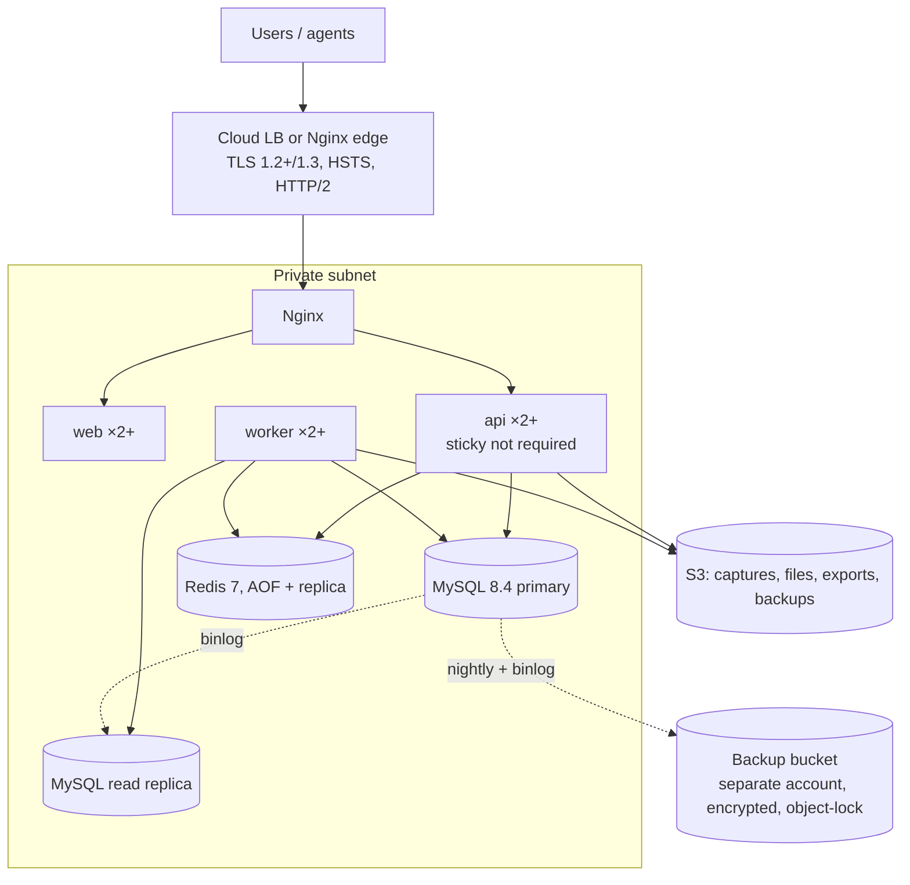

# Deployment Architecture

Phase 1 defined the target architecture; this page keeps it current. Step-by-step instructions are in
[deployment-guide.md](deployment-guide.md), [operations.md](operations.md),
[backup-restore.md](backup-restore.md) and [release-checklist.md](release-checklist.md). Where the
implementation differs from the original design, the row below says so.

## 1. Environments

| Env | Purpose | Data | Deploy trigger |
|---|---|---|---|
| local | Development | Seed data | `docker compose up` |
| ci | Automated tests | Ephemeral | Every PR |
| staging | Release candidate verification, ZAP scan, load tests | Synthetic + anonymized | Merge to `main` (auto) |
| production | Customers | Real | Tagged release, **manual approval** |

Each environment has its own credentials, buckets, KMS keys, and SMTP. Nothing is shared.

## 2. Production topology

- **Minimum viable production:** one VM (8 vCPU / 32 GB) running the compose stack plus managed MySQL and Redis, or self-hosted with replicas. **Recommended:** container platform (ECS/Kubernetes/Fly) with managed MySQL (RDS/Cloud SQL) and managed Redis.
- Socket.IO across API replicas uses `@socket.io/redis-adapter`. The LB must support WebSocket upgrade. Sticky sessions are only needed if long-polling is enabled; v1 forces `transports: ['websocket']` with a polling fallback behind stickiness.
- Images: `api` and `worker` are built from the same source with different entry commands (separate Dockerfiles as required, sharing a base stage). Node 24 Alpine/distroless, non-root, `HEALTHCHECK`.

## 3. Nginx responsibilities

TLS termination (Let's Encrypt via certbot, or LB-managed), HTTP→HTTPS redirect,
`/api/` → api upstream, `/socket.io/` → api with upgrade headers, `/` → web, gzip/brotli,
request-ID propagation, `client_max_body_size 2m`, basic per-IP `limit_req` (the app keeps
fine-grained limits), security headers fallback, and no server tokens.

## 4. Configuration

All config comes from environment variables, validated by Zod at boot (the process exits
non-zero with a clear message on failure). The full list is documented in `.env.example`
during Phase 2. Main groups: `DATABASE_URL` (app user), `DATABASE_MIGRATE_URL` (migration
user, release job only), `DATABASE_REPLICA_URL`, `REDIS_URL`, `S3_*`, `SESSION_SECRET`,
`CSRF_SECRET`, `FIELD_ENCRYPTION_KEYS`, `AGENT_JWT_PRIVATE_KEY`, `SMTP_*`, `APP_ORIGIN`,
`SENTRY_DSN`, `LOG_LEVEL`.

## 5. Release & migrations

1. CI builds immutable images tagged with the git SHA, and scans them (Trivy).
2. Deploy to staging (auto). Smoke and E2E tests run there.
3. Production release (manual approval): **migration job** (`prisma migrate deploy` using the migrate user) runs only after a fresh snapshot is verified. Then a rolling deploy of api/worker/web.
4. **Expand/contract migrations only**: add nullable columns or tables → deploy code that writes both → backfill job → switch reads → drop old in a later release. That keeps every release rollback-safe.
5. **Rollback:** redeploy the previous image tag. The schema stays backward-compatible because of expand/contract. Restoring the DB from snapshot is a last resort, documented with its RPO impact.

## 6. Observability

| Signal | Implementation |
|---|---|
| Logs | pino JSON to stdout → Loki/CloudWatch. Fields: `requestId`, `orgId`, `userId`, `route`, `status`, `durationMs`. |
| Metrics | `prom-client` `/metrics` on `METRICS_PORT` (internal): HTTP latency by route pattern, queue depth by state, job durations and failures, outbox lag, pending webhooks, process metrics. *Not built:* DB pool, screenshot pipeline and socket gauges |
| Errors | JSON logs with request IDs and the 5xx metric. *Not built:* Sentry (`SENTRY_DSN` is accepted but unused) |
| Dashboards/alerts | Grafana: API p95 > 500 ms (10 min), 5xx > 1%, queue failed > 0 in DLQ, outbox lag > 2 min, readiness failing, disk > 80%, backup job failure, restore-verify failure |
| Health | `/health/live` (process up), `/health/ready` (DB `SELECT 1`, Redis `PING`, S3 `HeadBucket`, migrations applied). Graceful shutdown: stop accepting → drain HTTP (25 s) → close sockets → finish active jobs → close pools. |
| Queues | Queue depth and failures via metrics and alerts. *Not built:* a queue admin UI (Bull Board) |

## 7. Backups & DR

| Item | Method | Frequency | Retention |
|---|---|---|---|
| MySQL full | Managed snapshots **or** `xtrabackup` / `mysqldump --single-transaction` | Nightly | 35 days |
| MySQL PITR | Binlog shipping to the backup bucket | Continuous (≤ 15 min) | 7 days |
| Encryption | `age` (or KMS) before upload. Backup bucket in a separate account with object lock (compliance mode). | | |
| Redis | AOF. Treated as rebuildable: queues recover from the outbox, cache is disposable. | | |
| Object storage | Cross-region replication for `files/` (documents, invoices). Captures are deliberately **not** replicated beyond the primary region (privacy/retention), which is documented as an accepted risk. | | |
| Restore verification | Scheduled job restores the latest backup to an isolated instance, runs migrations status + row-count and checksum queries, then tears down. Alerts on failure. | Weekly | |

**RPO ≤ 15 min requires managed MySQL point-in-time recovery** (binary-log shipping for self-hosted MySQL is not built; daily backups alone give RPO ≤ 24 h). **RTO ≤ 4 h.** Runbooks and the 2026-10-22 restore drill: [backup-restore.md](backup-restore.md). Reports currently read the primary; the read replica in the diagram is not used yet (`DATABASE_REPLICA_URL`).

## 8. Desktop agent distribution

electron-builder produces a signed `.dmg` (Apple Developer ID, notarized) and a signed
`.exe`/NSIS installer (Authenticode, preferably EV). Auto-update feed via
`electron-updater` from a private S3/CloudFront path. Release channels: `beta`, `stable`.
Signing credentials live only in the CI secret store. **External prerequisite:** Apple
Developer and code-signing certificates must be purchased by the company.
