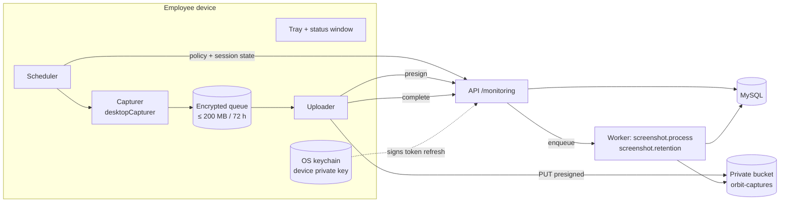

# Screenshot Capture & Storage Design

## 1. Principles (non-negotiable)

1. **Transparent.** Capture happens only while the employee is clocked in and working (not on break, timer not paused under the "timer-only" mode). A visible indicator (tray icon state + optional toast on each capture) is always present. The employee has a `/monitoring` page showing exactly what is captured, how often, who can see it, and for how long.
2. **Notice before capture.** No capture until the employee has acknowledged the *current* policy version's notice in the agent or web app. Withdrawal stops capture immediately. What happens employment-wise after withdrawal is an HR matter outside the system, and the UI says so.
3. **No covert or bypass behavior.** The agent relies on OS permissions (macOS Screen Recording, Windows Graphics Capture). It never hides from the process list, never auto-starts without a visible tray icon, and never captures without the OS permission granted.
4. **Minimization.** Configurable blur, active-screen-only mode, app exclusions, and no keystroke, clipboard, URL-content, microphone, or webcam capture. Idle detection records only the *duration* of no input (OS idle time API), never input contents.
5. **Least-privilege access.** Viewers need a scoped permission. Every view or download is logged. Binaries live only in private storage behind short-lived signed URLs.

## 2. Components



## 3. Policy model & precedence

- `capture_policies` at three levels: **ORG** (exactly one), **TEAM**, **MEMBER**. Each publish creates an immutable `monitoring_policy_versions` row.
- **Effective policy** for a member is resolved as:
  1. If the ORG policy is inactive → monitoring **off** for everyone (master switch).
  2. Else, if a MEMBER-level assignment exists → use it.
  3. Else, if the member is in teams with TEAM assignments → choose the highest `priority`. Ties go to the **least invasive** policy (disabled > longer interval > blur on).
  4. Else → ORG policy.
  5. The result is clamped to the ORG `min_interval_s`/`max_interval_s`. The **retention** is `min(level retention, org retention)`, so lower levels can only shorten it.
- The effective version ID is returned to the agent and stored on every screenshot.
- Policy change → outbox `monitoring.policy.changed` → socket push to affected agents → agents re-fetch. Agents also re-fetch on every heartbeat (every 60 s, with ETag).
- A new version with a materially changed notice (hash differs) requires re-acknowledgement before capture resumes.

## 4. Agent lifecycle

| Step | Detail |
|---|---|
| Pairing | The employee signs in on the web, opens `/monitoring`, and clicks "Connect desktop app". The server issues a one-time 8-character pairing code (5 min TTL). The agent generates an **Ed25519 keypair**, stores the private key in the OS keychain via `keytar` / Electron `safeStorage`, and calls `POST /monitoring/agents/register {pairingCode, publicKey, deviceInfo}`. |
| Tokens | The server returns a 15-min access token (JWT, `aud=agent`, `sub=agentId`, `org`, `mem`). To refresh, the agent requests a nonce, signs `nonce‖agentId‖ts` with the device key, and posts to `/auth/refresh`. **No refresh token is stored**: the private key *is* the credential, and it never leaves the keychain. |
| Revocation | `desktop_agents.status=REVOKED` (by the employee, an admin, offboarding, or a password reset with "sign out everywhere"). The next refresh or heartbeat fails with 401 `AGENT_REVOKED`. The agent wipes its queue and keys and shows a "Disconnected" state. |
| Heartbeat | Every 60 s: state, queue depth, last error, version. The server responds with the effective policy ETag, the work state (WORKING / ON_BREAK / OFF), and a capture permit. |
| Updates | electron-updater with code-signed builds (Apple Developer ID + notarization, Windows Authenticode). The update feed is served over HTTPS and signatures are verified before install. |

## 5. Capture loop

```
every tick (1 s scheduler, jittered):
  if not (consented && policy.enabled && workState == WORKING && timer rules satisfied
          && within policy.schedule && OS permission granted && agent ACTIVE): show "Paused (reason)"; continue
  if now >= nextCaptureAt:
      frontmost app ∈ excluded_apps → record a "skipped: excluded" event (count only); schedule next
      image = desktopCapturer(capture_mode) → downscale to max 1920px wide → blur if policy → WebP q=70
      strip metadata; sha256; enqueue {clientCaptureId: uuidv7, capturedAt, policyVersionId, projectId, taskId}
      nextCaptureAt = now + interval ± random(0..20% of interval)   # random offset within interval, disclosed in notice
      indicator flash + optional notification
```
The server is authoritative on whether capture *should* happen. The agent never captures
on a stale permit older than 2 heartbeats (≈ 2 min). Going offline means capture continues
only until the permit expires, then pauses.

## 6. Upload pipeline

```mermaid
sequenceDiagram
  autonumber
  participant A as Agent
  participant API as API
  participant DB as MySQL
  participant S3 as Object storage
  participant W as Worker
  A->>API: POST /monitoring/uploads/presign {clientCaptureId, capturedAt, sha256, size, mime, w, h}
  API->>DB: verify agent, consent, effective policy, session covers capturedAt, rate
  API->>DB: INSERT screenshots (PENDING_UPLOAD) ON DUPLICATE (agent, clientCaptureId) → reuse
  API->>S3: presign PUT tmp/{org}/{yyyy}/{mm}/{dd}/{screenshotId}.webp<br/>(content-type, content-length, x-amz-checksum-sha256 bound; 5 min)
  API-->>A: {screenshotId, url, headers}
  A->>S3: PUT image (S3 rejects checksum/size mismatch)
  A->>API: POST /monitoring/uploads/complete {screenshotId}
  API->>S3: HEAD → verify size, content-type, checksum
  API->>DB: status=UPLOADED, uploaded_at; outbox screenshot.process
  API-->>A: 200 (agent deletes local copy)
  W->>S3: GET tmp object → decode with sharp (rejects non-images, dimension check, re-encode, thumbnail 320px)
  W->>S3: PUT captures/{org}/{yyyy}/{mm}/{screenshotId}.webp + thumbs/…; DELETE tmp object
  W->>DB: status=READY, storage_key, thumb_key, retention_expires_at = captured_at + retention_days
  Note over W,DB: failure → status=FAILED/REJECTED (failure_code), notify after N failures per member/day
```

- **Idempotency:** `UNIQUE(organization_id, agent_id, client_capture_id)`. Retried presigns return the same `screenshotId`. Retried `complete` calls on an already-UPLOADED or READY row return 200 unchanged. Processing jobs use `jobId = screenshotId`.
- **Agent retry policy:** exponential backoff 2 s → 5 min cap, with jitter. The queue holds at most 200 MB / 72 h (configurable lower). The oldest items are evicted first and reported as `DROPPED_QUEUE_FULL` / `EXPIRED` via `POST /uploads/fail`, so coverage reports reflect them honestly.
- **Local queue encryption:** AES-256-GCM. The key is generated per install and stored in the keychain. Files are deleted after a successful `complete` or on expiry, revocation, or sign-out.
- **Stuck uploads:** a sweeper job marks `PENDING_UPLOAD` rows older than 24 h as `FAILED (UPLOAD_TIMEOUT)`. The `tmp/` lifecycle rule deletes orphaned objects after 24 h.

## 7. Storage layout & access

| Item | Value |
|---|---|
| Bucket | `orbit-captures-<env>`. Block Public Access on. SSE-S3 (or SSE-KMS per org in an enterprise tier). Versioning off (deletion must be final). |
| Keys | `tmp/…` (unvalidated), `captures/{orgId}/{yyyy}/{mm}/{id}.webp`, `thumbs/{orgId}/…`. IDs are UUIDv7, so they are unguessable. |
| Access | `GET /monitoring/screenshots/:id/access-url?variant=thumb\|full\|download` → authorization → access log row → a presigned GET valid for **60 s** with `response-content-disposition` set for downloads. The gallery requests thumbs in batches (one log row per batch view, `VIEW_THUMB`). |
| Never | Public URLs, binaries in MySQL, URLs in logs, or long-lived URLs in notifications or emails |
| CORS | Bucket CORS allows `GET` only from the app origin (for ``) and `PUT` from any origin, because the agent is not a browser. The presign constraints still protect uploads. |

## 8. Retention, deletion, legal hold

- **Daily retention job** (02:00 UTC, BullMQ repeatable, idempotent): selects `status=READY AND retention_expires_at < now AND legal_hold=false` in batches of 500 via the `(status, retention_expires_at)` index. It deletes objects with S3 `DeleteObjects`, then sets `status=DELETED`, nulls the keys, and writes `screenshot_deletion_logs(reason=RETENTION)`. Partial failures are retried. A row is marked DELETED only after the object deletion is confirmed.
- **Manual delete** (owner): same path, `reason=MANUAL`, audited. Blocked under legal hold (409 `LEGAL_HOLD`).
- **Legal hold:** targets members or projects plus a date range. Creating a hold sets the cached `legal_hold=true` on matching rows. Captures arriving later are checked at insert time. Releasing a hold recomputes the flag. All hold actions are audited.
- **Offboarding:** captures follow normal retention unless the org opts into "delete on exit".
- **Retention reduced on a policy:** applies to new captures. A one-off "apply to existing" admin action exists and is audited.

## 9. Gallery (manager & employee)

Filters: member, project, task, date/time range, status. Timeline grouped by hour, with
gaps shown explicitly ("on break", "paused: excluded app", "upload failed", "agent
offline") so absence of screenshots is never misread. Tiles show capture time (viewer's
time zone), project/task, and policy interval. The viewer modal adds full size,
download (if permitted), work-session context, upload status, retention expiry, and access
history (owner only). The deletion history view lists deleted captures as metadata only.

## 10. Monitoring reports

- **Coverage** = ok ÷ expected (see the KPI table in requirements). Broken down by member and day. Reason codes come from agent events.
- **Upload failures** by code, agent version, and OS.
- **Storage usage** per org: Σ `size_bytes` of READY rows plus thumbs, compared against the org storage limit, with alerts at 80% and 95%.
- **Agent health:** last-seen age, version distribution, revoked count.
- Reports never rank employees by screenshot counts and never label counts as productivity.

## 11. Browser-only fallback (explicit limitation)

The web app **does not** capture the desktop. An optional "web capture" mode using
`getDisplayMedia()` is *not* planned for v1. It requires a user gesture and a permission
prompt per session, stops when the tab closes, and gives an incomplete picture. Orgs that
need screenshots must deploy the desktop agent. Without it, the gallery shows "No agent
connected".

## 12. As built (Phase 7) — differences from the design above

| Design | As built | Why |
|---|---|---|
| Agent encodes WebP | The agent uploads **JPEG** (Electron's `nativeImage` has no WebP encoder). The worker re-encodes everything to WebP and strips metadata. | Only validated, re-encoded images are stored, whatever the client sends. |
| `x-amz-checksum-sha256` bound in the presigned PUT | The size and type are bound. The **SHA-256 is verified by the worker** after download; a mismatch → `REJECTED (CHECKSUM_MISMATCH)`. | Checksum signing support varies across S3-compatible stores (SeaweedFS in dev). |
| `/auth/refresh` for agents | `/monitoring/agent/challenge` → sign `orbit-agent-token\n{agentId}\n{nonce}\n{ts}` → `/monitoring/agent/token`. Only the latest nonce is valid; it is stored as a hash and consumed atomically. | Keeps agent auth inside the monitoring module. |
| Policy change → socket push to agents | Agents pick up changes on the next heartbeat (≤ 60 s). | No socket client in the agent yet; the permit already expires after 2 minutes without a heartbeat. |
| Notice hash = notice text | The hash covers the text **and** every material setting (capture on/off, interval, blur, screens, excluded apps, idle, retention). | Any change to what is captured or kept requires a new acknowledgement. |
| ALL_SCREENS = one image | One capture per display (each with its own `clientCaptureId`). | No compositing in the main process. |
| Gallery thumbs logged once per batch | One `VIEW_THUMB` row per screenshot shown. | Each screenshot's access history is complete. |
| Legal hold date range | Ranges are **UTC calendar dates**. | Holds are legal instruments; a fixed zone avoids ambiguity. |
| Excluded apps | If an exclusion list exists and the front app cannot be determined, the capture is **skipped** (counted locally). | Errs on the side of not capturing. On macOS, determining the front app triggers the system Automation prompt. |
| Idle detection | Recorded since Phase 8: the agent reports idle intervals (≥ 5 min without input, start and end only) via `POST /monitoring/agent/idle`; the API clips them to working time. | |
| Retention reduced → "apply to existing" | Not built; new retention applies to new captures. | Deferred. |
| Offboarding | Devices are revoked when a member is deactivated or offboarded, and on any password reset (all organizations). Captures follow normal retention. | |
